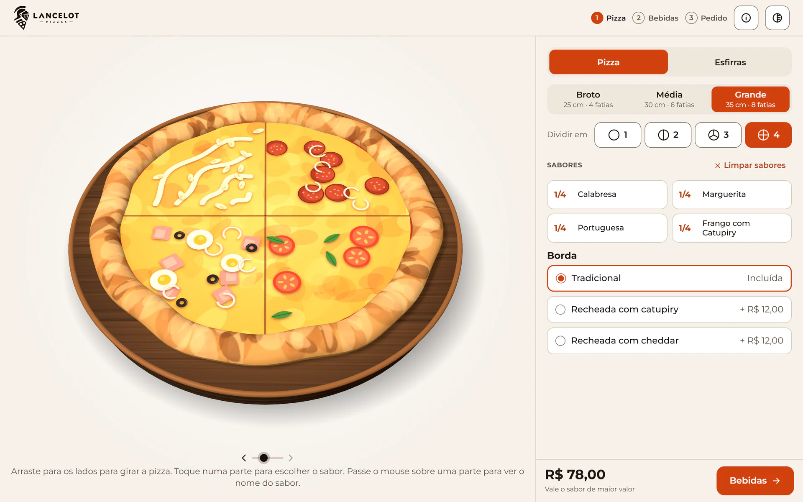
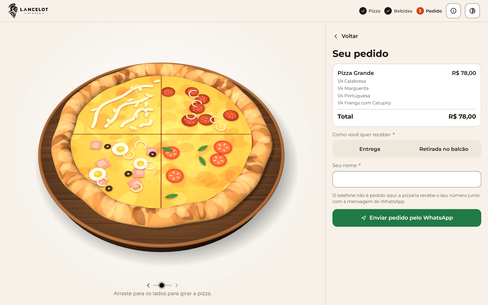
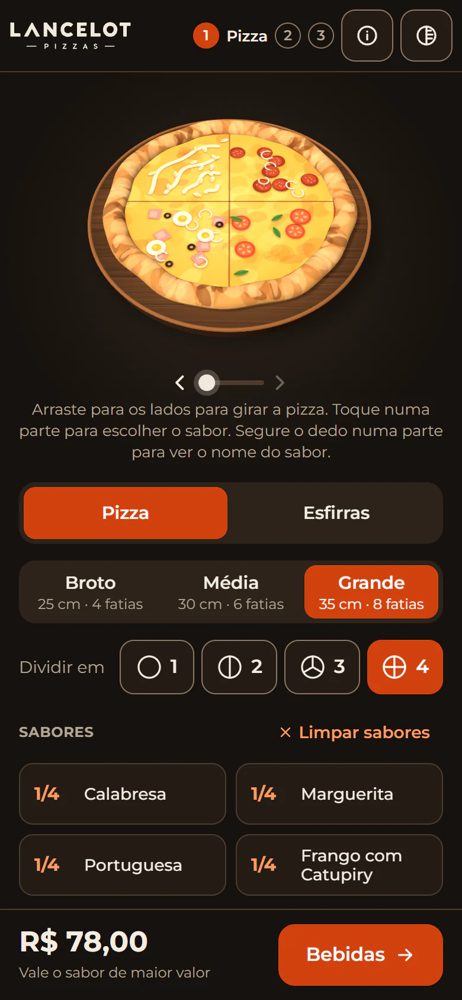

# Lancelot Pizzas

Site de pedidos para pizzaria em que o cliente **monta a pizza em 3D**: escolhe o tamanho, divide em até 4 sabores, tira ingredientes, soma adicionais, escolhe a borda e as bebidas e envia o pedido pronto pelo **WhatsApp**, sem precisar de cadastro. A pizzaria gerencia pedidos, cardápio e preços num painel administrativo.

Este repositório é o **front-end** (Nuxt 4). A API fica em [backendLancelotPizzas](https://github.com/nathanhenrick/backendLancelotPizzas).



| Resumo do pedido | Celular, tema escuro |
| --- | --- |
|  |  |

## Funcionalidades

- Pizza em 3D feita com Three.js, que gira com o mouse ou com o dedo, dividida em 1, 2, 3 ou 4 sabores.
- Personalização de cada sabor: tirar ingredientes, somar adicionais e deixar uma observação.
- Tamanhos, bordas recheadas, esfirras e bebidas (também em 3D), com a prévia do preço na hora.
- Resumo do pedido enviado direto para o WhatsApp da pizzaria, com entrega ou retirada no balcão.
- Painel administrativo: dashboard, pedidos atualizados a cada 30 s, sabores com prévia 3D, tamanhos e preços, bordas, esfirras, adicionais, bebidas, dados da pizzaria e usuários.
- Desenvolvido mobile-first, com tema claro e escuro.
- Acessível por teclado e leitor de tela, inclusive a pizza 3D.
- Páginas públicas renderizadas no servidor (SSR) e preparadas para SEO.
- O preço exibido é só prévia: o total é sempre calculado pela API.

## Tecnologias

Nuxt 4, Vue 3, TypeScript, Pinia, Three.js, axios e Bootstrap (só no painel). A API usa Laravel 13, Sanctum e MySQL.

## Rodar com Docker

Só precisa do [Docker](https://www.docker.com/products/docker-desktop/). Clone este repositório e, dentro da pasta dele, rode:

```bash
docker compose up --build
```

O `docker-compose.yml` baixa e constrói a API direto do GitHub e sobe três containers: MySQL, API e site. Na primeira vez, a API cria as tabelas e o cardápio de exemplo sozinha.

| O quê | Endereço |
| --- | --- |
| Loja (cardápio e montador) | http://localhost:3000/loja |
| Montador de pizza | http://localhost:3000/pizza |
| Painel administrativo | http://localhost:3000/login |
| API | http://localhost:8000/api/v1 |

Acesso ao painel: `admin@montapizza.local` / `montapizza123`. São credenciais só para rodar localmente e podem ser trocadas com `ADMIN_EMAIL` e `ADMIN_SENHA`.

Outras opções:

- Portas ocupadas: `SITE_PORT=3100 API_PORT=8100 docker compose up --build`.
- API clonada localmente em vez da do GitHub: `BACKEND_PATH=../backendLancelotPizzas docker compose up --build`.
- Parar: `docker compose down`. Parar e apagar o banco: `docker compose down -v`.

No Docker o navegador chama a API por `localhost`, mas o servidor do Nuxt (SSR) a chama pela rede interna. Por isso existe `NUXT_API_BASE_URL_SERVIDOR`, que só vale no servidor.

## Rodar sem Docker

Requisitos: Node.js 20 ou mais novo e a [API](https://github.com/nathanhenrick/backendLancelotPizzas) rodando (veja o README dela).

```bash
npm install
npm run dev
```

O site abre em http://localhost:3000 e fala com a API em `http://localhost:8000/api/v1`. Para mudar algo, copie `.env.example` para `.env`.

| Variável | Para quê |
| --- | --- |
| `NUXT_PUBLIC_API_BASE_URL` | Endereço da API usado pelo navegador, terminando em `/api/v1` |
| `NUXT_API_BASE_URL_SERVIDOR` | Endereço da API usado pelo servidor do Nuxt (opcional; vazio usa o de cima) |
| `NUXT_PUBLIC_SITE_URL` | Endereço público do site, usado no canonical e no Open Graph |
| `NUXT_PUBLIC_WHATSAPP` | WhatsApp reserva, usado só se o painel não tiver número |

Build de produção: `npm run build` e depois `node .output/server/index.mjs`.

## Estrutura (`app/`)

- `pages/pizza.vue` e `pages/esfirras.vue`: o montador. A pizza fica no palco e o painel lateral troca de etapa (pizza, bebidas, pedido).
- `pages/index.vue`: landing page (`components/Landing*`, layout `landing`); a escolha entre pizza e esfirras fica em `/loja`.
- `pages/admin/`: painel administrativo (ver abaixo); o login fica em `pages/login.vue`.
- `stores/pedido.ts`: estado do pedido, prévia dos preços e a mensagem do WhatsApp. Ao enviar, só as escolhas vão para a API, que calcula e devolve o total.
- `stores/cardapio.ts`: cardápio carregado da API (no servidor, para a página já chegar pronta).
- `stores/auth.ts` e `middleware/admin.global.ts`: login do painel (token da API num cookie).
- `services/`: um arquivo por recurso da API, expostos como `$services`. O axios (endereço, token, 401) fica em `plugins/services.ts`.
- `utils/erroApi.ts`: transforma o erro da API (validação, 4xx) no texto mostrado na tela.
- `data/cardapio.ts`: estrutura de partida (tamanhos, faixas) usada só enquanto o cardápio não carrega.
- `data/ingredientes.ts`: biblioteca de ingredientes visuais; um sabor é uma lista desses ids.
- `lib/pizza/`: a pizza em si.
  - `renderer.ts`: cena Three.js (massa, borda, tábua, luz, sombra) e a simulação 2.5D para quem não tem WebGL.
  - `textura.ts`: pinta a superfície (queijo, partes, divisas) num canvas 2D que vira a textura do topo.
  - `ingredientes.ts`: o desenho de cada ingrediente.
- `components/`: `Base*` são genéricos; `Pizza*`, `Flavor*`, `Part*`, `Step*` e `Order*` são do montador; `HeaderTemplate`, `ModalTemplate`, `SearchInput`, `Pagination`, `PrimaryButton`, `SecButton`, `Loader` e a pasta `admin/` são do painel.

## Gestos na pizza (`PizzaCanvas.vue`)

- **Arrastar para os lados** gira a pizza (ou a bebida sob o dedo).
- **Tocar ou clicar numa parte** abre a escolha de sabor daquela parte.
- **Passar o mouse numa parte** (computador) ou **segurar o dedo nela por ~0,45 s** (celular) mostra um balão com o nome do sabor (`1/4 · Calabresa`). Soltar depois de segurar só fecha o balão, não escolhe a parte.
- A dica sob a pizza (`PizzaStage.vue`) explica o gesto certo para cada aparelho. Quem usa teclado ou leitor de tela tem a lista de partes (`PartList`), que diz o sabor de cada uma.

## Painel administrativo (`/admin`)

Telas: Dashboard, Pedidos, Sabores (salgadas e doces), Tamanhos e preços, Bordas, Esfirras, Adicionais, Bebidas (o long neck leva a logo da marca no rótulo), Pizzaria (nome, WhatsApp e regra de preço), Política de privacidade e Usuários.

- **Login** em `/login`. Sem sessão, qualquer tela do painel leva para lá e volta depois de entrar. O primeiro acesso é criado pelo seeder da API.
- Layout em `layouts/admin.vue`; o menu é a lista `MENU` no topo do arquivo. A tela de login usa `layouts/auth.vue`.
- Bootstrap e Bootstrap Icons são carregados só nesses layouts, para não mexer no site público.
- As telas de cadastro seguem o mesmo molde: `useCrud` (carregar, buscar, paginar), `ModalTemplate` com o formulário, tabela no desktop e cartões no celular.
- A lista de pedidos se atualiza sozinha a cada 30 s.

## Novo sabor ou ingrediente

- Sabor: cadastre em `/admin/sabores` marcando os ingredientes (há uma prévia 3D no formulário).
- Ingrediente: registre quantidade e raio em `data/ingredientes.ts` e o desenho em `PECAS` (`lib/pizza/ingredientes.ts`).

## Tema e acessibilidade

- Tema: segue o navegador ou o sistema; sem preferência, claro. O botão do cabeçalho salva a escolha. Cores em `assets/css/main.css`.
- Tudo o que se faz tocando na pizza também se faz pela lista de partes, por teclado e leitor de tela.
- Mudanças visuais (pizza dividida, sabor aplicado) são anunciadas por `useAnuncio`.
- `prefers-reduced-motion` desliga as animações, inclusive as da pizza.
- O módulo `@nuxt/a11y` aponta problemas de acessibilidade no DevTools do Nuxt durante o `npm run dev`.

## Licença

Copyright © 2026 Nathan Henrick. **Todos os direitos reservados.** O código está público só para consulta e avaliação pessoal; qualquer uso comercial, cópia, modificação ou distribuição depende de autorização por escrito do autor. Veja [LICENSE](LICENSE).
